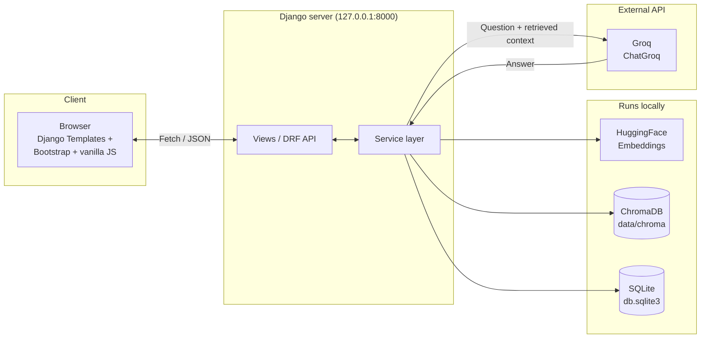
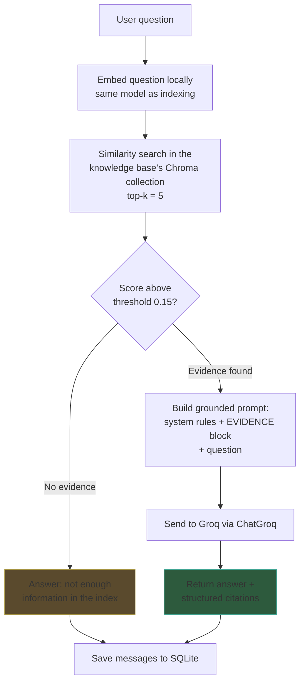
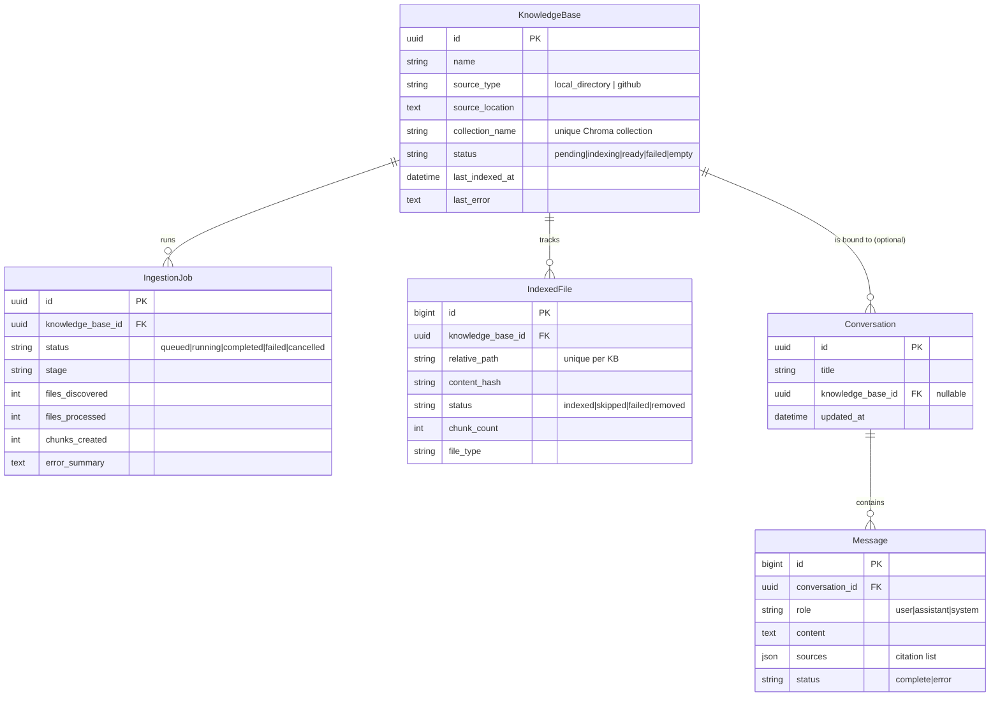

# Personalised RAG

A local, single-user **Retrieval-Augmented Generation** web application. Point it at a
folder on your computer (or a public GitHub repository), and it will parse the documents
inside, split them into chunks, embed them locally, and store the vectors in a persistent
local database. You can then ask questions in a chat interface and get answers grounded in
*your own files* — with citations back to the exact source (file, page, sheet, or row).

> **Why this project exists**
>
> This is my first project built while learning how a RAG pipeline actually works end to
> end. The overall design — the load → split → embed → store → retrieve → generate
> sequence that every RAG system follows — was learned from
> [**krishnaik06/RAG-Tutorials**](https://github.com/krishnaik06/RAG-Tutorials). That
> repository's clear, notebook-by-notebook walkthrough of the RAG steps is what made the
> pipeline click for me, and the architecture here is directly inspired by it. What I
> added on top was turning the concept into a real, modular, production-shaped Django
> application: a browser UI, a REST API, incremental indexing, persistent storage, prompt
> -injection defences, and a full test suite. Huge credit to that repository for teaching
> the fundamentals — go star it.

---

## Table of contents

- [Features](#features)
- [How it works](#how-it-works)
- [Tech stack](#tech-stack)
- [Supported file formats](#supported-file-formats)
- [Prerequisites](#prerequisites)
- [Setup](#setup)
- [Running the app](#running-the-app)
- [Using the app](#using-the-app)
- [Environment variables](#environment-variables)
- [API reference](#api-reference)
- [Project structure](#project-structure)
- [Testing](#testing)
- [Security & privacy](#security--privacy)
- [Known limitations](#known-limitations)
- [Acknowledgements](#acknowledgements)

---

## Features

- **Local directory ingestion** — index any folder inside an approved root (path-traversal
  safe, symlink-safe).
- **GitHub repository ingestion** — clone a public repo into a managed workspace; its code
  is *never* executed.
- **43 supported file extensions** across PDF, Word, Excel, HTML, Markdown, plain text,
  CSV, and ~30 source-code/notebook formats.
- **Incremental, idempotent indexing** — content hashes mean unchanged files are skipped on
  re-run, changed files have their old chunks replaced, and deleted files have their
  vectors cleaned up. Re-indexing never duplicates data.
- **Local embeddings** — `sentence-transformers/all-MiniLM-L6-v2` runs on your machine;
  vectors never leave it.
- **Persistent ChromaDB** — one collection per knowledge base, cosine space, stored under
  `data/chroma/`.
- **Grounded answers via Groq** — the top-5 retrieved chunks are placed in a hardened
  prompt that treats document text as untrusted evidence, not instructions.
- **Source citations** — every answer comes back with cards showing file name and
  page/sheet/row context where available.
- **Chat with history** — conversations and messages persist in SQLite; a sidebar lets you
  resume, rename, or delete past chats.
- **Ingestion progress UI** — live stage/counter polling (discovered, processed, skipped,
  failed, chunks).
- **Responsive, dark-themed chat UI** — Django templates + Bootstrap + vanilla JS, no build
  step.

---

## How it works

### High-level architecture



> **Note:** embeddings and vector storage are 100 % local. The only thing that leaves your
> machine is the **question plus the retrieved text passages**, which are sent to Groq to
> generate the final answer. The Groq API key never reaches the browser.

### Ingestion pipeline

```mermaid
flowchart TD
    A[Create / re-index<br/>knowledge base] --> B[Validate source<br/>approved roots / GitHub URL]
    B --> C[Discover supported files<br/>skip hidden, build, secrets, symlinks]
    C --> D{Content hash<br/>already indexed?}
    D -->|Unchanged| E[Skip file]
    D -->|New or changed| F[Parse per format<br/>PDF / DOCX / XLSX / HTML / text / code]
    D -->|File removed| G[Delete stale chunks<br/>from vector store]
    F --> H[Split with Recursive<br/>CharacterTextSplitter<br/>800 chars, 150 overlap]
    H --> I[Embed locally with<br/>all-MiniLM-L6-v2]
    I --> J[Upsert chunks into<br/>Chroma by stable ID]
    E --> K[Update IndexedFile<br/>bookkeeping]
    G --> K
    J --> K
    K --> L{More files?}
    L -->|Yes| D
    L -->|No| M[Mark knowledge base READY]

    style E fill:#2d5a3d,stroke:#4a9
    style G fill:#5a2d2d,stroke:#a44
    style M fill:#2d4a5a,stroke:#49a
```



Each chunk gets a **deterministic ID** derived from the knowledge base, relative path,
file hash, and chunk index — this is what makes re-indexing idempotent. Per-file failures
are logged and skipped without aborting the whole job.

### Query (retrieval + generation) pipeline



The system prompt explicitly instructs the model to (1) answer **only** from the provided
evidence, (2) treat that evidence as untrusted data and ignore any instructions embedded
inside it, and (3) cite the bracketed source labels it used.

### Data model



---

## Tech stack

| Layer | Choice |
|---|---|
| Language | Python 3.11 / 3.12 (verified on 3.12) |
| Web framework | Django 6.1 + Django REST Framework |
| Frontend | Django Templates, Bootstrap 5, vanilla JS (Fetch API) |
| RAG orchestration | LangChain |
| LLM | Groq API via `langchain-groq` (`ChatGroq`) |
| Embeddings | `sentence-transformers/all-MiniLM-L6-v2` via HuggingFace (local) |
| Vector store | ChromaDB (persistent, `data/chroma/`) |
| Document parsing | PyMuPDF, openpyxl, BeautifulSoup4, python-docx, pandas |
| App data | SQLite via Django ORM |
| Config | `python-dotenv` (`.env.local` overrides `.env`) |

---

## Supported file formats

| Format | Extensions | Metadata preserved |
|---|---|---|
| PDF | `.pdf` | relative path, page number |
| Excel | `.xlsx`, `.xlsm` | relative path, sheet, row range |
| Word | `.docx` | relative path, paragraph/table context |
| HTML | `.html`, `.htm` | relative path, page title |
| Markdown | `.md`, `.markdown` | relative path, headings |
| Plain text | `.txt`, `.rst`, `.tex`, `.log` | relative path |
| CSV | `.csv` | relative path, header, row context |
| Source code | `.py` `.js` `.ts` `.java` `.go` `.rb` `.rs` `.sql` `.json` `.yaml` `.yml` `.toml` `.xml` `.sh` `.ipynb` … (43 total) | relative path, language/extension |

Hidden folders, build/cache folders (`node_modules`, `.git`, `dist`, …), secret files
(`.env`, `id_rsa`, `*.pem`, …), symlinks, and oversized files are skipped automatically.

---

## Prerequisites

- **Python 3.11 or 3.12**
- **Git** (only if you want to index GitHub repositories)
- A **Groq API key** — get one at <https://console.groq.com/keys>

---

## Setup

```bash
# 1. Clone and enter the project
git clone <your-repo-url>
cd Personalised_RAG

# 2. Create and activate a virtual environment
python3 -m venv .venv
source .venv/bin/activate          # macOS / Linux
# .venv\Scripts\Activate.ps1       # Windows PowerShell

# 3. Install dependencies
pip install --upgrade pip
pip install -r requirements.txt

# 4. Configure your environment
cp .env.example .env.local
#    Open .env.local and set at least:
#      GROQ_API_KEY=your_key_here
#      ALLOWED_SOURCE_ROOTS=/absolute/path/to/your/documents

# 5. Apply database migrations
python manage.py migrate
```

> **Windows note:** if PowerShell blocks activation, either use
> `.venv\Scripts\activate.bat` in Command Prompt or adjust the execution policy for the
> current user.

---

## Running the app

### Option A — launch script (recommended)

```bash
# macOS / Linux
./run_dev.sh

# Windows PowerShell
.\run_dev.ps1
```

The script activates the virtual environment, runs Django system checks, refuses to start
if a server is already listening on port 8000, starts the development server, and opens
your browser to <http://127.0.0.1:8000/>.

### Option B — manual

```bash
source .venv/bin/activate
python manage.py runserver
```

Then open <http://127.0.0.1:8000/> in your browser.

> The development server is bound to `127.0.0.1` and is intended for **local, single-user
> use only**. Do not expose it to a public network.

---

## Using the app

1. **Add a source** — click *Add a source*, choose *Local folder* or *GitHub repository*,
   give it a name, and enter the path / URL. The folder must live inside one of the
   `ALLOWED_SOURCE_ROOTS` you configured.
2. **Wait for indexing** — the ingestion panel shows live progress (discovering → parsing
   → chunking → embedding → done). When the knowledge base turns **Ready**, the chat
   composer unlocks.
3. **Ask a question** — type a question and press Enter. The app embeds it locally,
   retrieves the top-5 relevant chunks, sends them (plus your question) to Groq, and
   returns an answer with source cards.
4. **Manage conversations** — use the sidebar to start a new chat, switch between past
   chats, rename them, or delete them. Each conversation remembers the knowledge base it
   was bound to.
5. **Re-index** — if you changed files on disk, hit *Re-index* on the knowledge base.
   Only new/changed files are re-processed; removed files are cleaned up automatically.

---

## Environment variables

Copy `.env.example` to `.env.local` and edit. `.env.local` takes precedence over `.env`.
All values have sensible defaults except `GROQ_API_KEY`.

| Variable | Default | Purpose |
|---|---|---|
| `GROQ_API_KEY` | *(required)* | Groq API key |
| `GROQ_MODEL` | `openai/gpt-oss-20b` | Groq chat model (change to any model your account supports) |
| `GROQ_TEMPERATURE` | `0.2` | Sampling temperature |
| `GROQ_MAX_TOKENS` | `1024` | Max answer length |
| `GROQ_REQUEST_TIMEOUT` | `60` | Groq request timeout (seconds) |
| `EMBEDDING_MODEL` | `sentence-transformers/all-MiniLM-L6-v2` | Local embedding model |
| `EMBEDDING_DEVICE` | `cpu` | `cpu` or `cuda` |
| `EMBEDDING_BATCH_SIZE` | `32` | Embedding batch size |
| `CHROMA_PERSIST_DIRECTORY` | `./data/chroma` | ChromaDB storage path |
| `CHROMA_COLLECTION_PREFIX` | `kb` | Prefix for collection names |
| `CHROMA_SPACE` | `cosine` | Distance space |
| `REPOSITORY_WORKSPACE` | `./data/repositories` | Where GitHub repos are cloned |
| `ALLOWED_SOURCE_ROOTS` | *(home dir)* | `:`- or `;`-separated roots (or JSON array) that may be indexed |
| `MAX_SOURCE_FILES` | `5000` | Cap on discovered files |
| `MAX_FILE_SIZE_BYTES` | `26214400` (25 MB) | Cap on individual file size |
| `IGNORED_DIRECTORIES` | `.git,node_modules,…` | Comma-separated dir names never traversed |
| `SENSITIVE_FILE_NAMES` | `.env,credentials,id_rsa,…` | Comma-separated file names never indexed |
| `CHUNK_SIZE` | `800` | Chunk size (characters) |
| `CHUNK_OVERLAP` | `150` | Chunk overlap (characters) |
| `RETRIEVAL_K` | `5` | Number of chunks retrieved |
| `RETRIEVAL_SCORE_THRESHOLD` | `0.15` | Min cosine similarity to count as evidence (`0` disables) |
| `DJANGO_SECRET_KEY` | dev default | Django secret key |
| `DJANGO_DEBUG` | `True` | Debug mode (keep `True` for local use) |
| `DJANGO_ALLOWED_HOSTS` | `127.0.0.1,localhost` | Comma-separated hosts |
| `DJANGO_TIME_ZONE` | `UTC` | Display timezone |
| `DJANGO_LOG_LEVEL` | `INFO` | Log verbosity |

---

## API reference

All endpoints are under `/api/`. Unsafe methods require the CSRF token (handled
automatically by the browser UI).

### Knowledge bases

| Method | Path | Purpose |
|---|---|---|
| `GET` | `/api/knowledge-bases/` | List knowledge bases with counts and status |
| `POST` | `/api/knowledge-bases/` | Create a KB and queue ingestion → `202` |
| `GET` | `/api/knowledge-bases/{id}/` | KB detail + latest job |
| `DELETE` | `/api/knowledge-bases/{id}/` | Delete KB + its Chroma collection (body: `{"confirm": true}`) → `204` |
| `GET` | `/api/knowledge-bases/{id}/status/` | Poll ingestion stage/counters |
| `POST` | `/api/knowledge-bases/{id}/reindex/` | Queue incremental re-index → `202` |
| `GET` | `/api/knowledge-bases/{id}/files/` | List indexed/skipped/failed files (paginated, `?status=`, `?search=`) |

### Conversations & chat

| Method | Path | Purpose |
|---|---|---|
| `GET` | `/api/conversations/` | List recent conversations |
| `POST` | `/api/conversations/` | Create a conversation (optional `knowledge_base_id`) → `201` |
| `GET` | `/api/conversations/{id}/` | Load conversation + messages |
| `PATCH` | `/api/conversations/{id}/` | Rename / rebind knowledge base |
| `DELETE` | `/api/conversations/{id}/` | Delete conversation → `204` |
| `POST` | `/api/conversations/{id}/messages/` | Ask a question → answer + sources |

The message endpoint returns `502` on a Groq failure (retryable) and `400` if retrieval
fails. Your question is always preserved even if the answer fails.

---

## Project structure

```
Personalised_RAG/
├── manage.py
├── requirements.txt
├── .env.example              # documented template
├── .env.local                # your real config (git-ignored)
├── run_dev.sh                # launch script (macOS / Linux)
├── run_dev.ps1               # launch script (Windows)
├── data/
│   ├── .gitkeep
│   ├── chroma/               # persistent vector DB (git-ignored)
│   └── repositories/         # cloned GitHub repos (git-ignored)
│
├── config/                   # Django project settings
│   ├── settings.py           # env-driven config for the whole app
│   ├── urls.py
│   ├── wsgi.py
│   └── asgi.py
│
└── rag_app/                  # the application
    ├── models.py             # KnowledgeBase, IngestionJob, IndexedFile, Conversation, Message
    ├── admin.py
    ├── forms.py
    ├── serializers.py
    ├── views.py              # renders the SPA page
    ├── urls.py               # mounted at /api/
    │
    ├── api/
    │   ├── knowledge_base_views.py
    │   ├── chat_views.py
    │   ├── serializers.py
    │   └── exceptions.py
    │
    ├── services/             # all business logic lives here
    │   ├── source_manager.py       # validate local dirs / GitHub URLs
    │   ├── file_discovery.py       # find indexable files, apply exclusions
    │   ├── document_parser.py      # per-format parsers → LangChain Documents
    │   ├── chunking.py             # text splitting + stable chunk IDs
    │   ├── embeddings.py           # lazy, cached HuggingFace embeddings
    │   ├── vector_store.py         # ChromaDB access (thread-safe shared client)
    │   ├── ingestion_service.py    # the indexing pipeline
    │   ├── retrieval_service.py    # similarity search + source labels
    │   ├── llm_service.py          # Groq / ChatGroq + grounded prompt
    │   ├── rag_service.py          # end-to-end question answering
    │   └── conversation_service.py # chat persistence helpers
    │
    ├── tasks/
    │   └── ingestion_tasks.py      # background ingestion threads
    │
    ├── templates/rag_app/          # SPA shell + partials
    ├── static/rag_app/             # app.css, app.js
    └── tests/                      # 72 unit + integration tests
```

---

## Testing

```bash
source .venv/bin/activate
python manage.py test
```

All **72 tests** cover path validation, file exclusions, document parsing, chunk
metadata, stable IDs, incremental indexing, retrieval, chat persistence, API validation,
and failure handling. **Groq calls are mocked**, and embeddings use a deterministic fake
model, so the suite is fully hermetic (no network, no model downloads).

| Test module | Focus |
|---|---|
| `test_api.py` | KB + conversation endpoints, validation, home page |
| `test_source_manager.py` | Local path and GitHub URL validation |
| `test_document_parser.py` | Per-format parsing + structured errors |
| `test_file_discovery.py` | Discovery, exclusions, limits |
| `test_chunking.py` | Splitting, stable IDs, vector upsert/search/delete |
| `test_ingestion.py` | End-to-end pipeline, incremental re-index, cleanup |

---

## Security & privacy

- **Local-first** — embeddings and ChromaDB run entirely on your machine. Only the
  question and the retrieved text passages are sent to Groq.
- **Secrets never leak** — the Groq API key stays in `.env.local` (git-ignored) and is
  never returned to the browser or written to logs.
- **Approved roots only** — local directories must resolve inside `ALLOWED_SOURCE_ROOTS`;
  path traversal and symlink escapes are rejected after normalisation.
- **No code execution** — indexed repositories are cloned with `git` (argument arrays, no
  `shell=True`, timeouts, hardened environment) and their contents are never run.
- **Prompt-injection defence** — retrieved document text is wrapped in an EVIDENCE block
  and the system prompt tells the model to treat it as untrusted data, not instructions.
- **XSS-safe rendering** — all untrusted content is inserted via `textContent` or a
  Markdown renderer that escapes HTML first.
- **Secrets are not indexed** — `.env` files, private keys, and credential files are
  skipped during discovery.
- **Safe deletion** — deleting a knowledge base removes its Chroma collection and
  associated DB records; deleting local app data (`db.sqlite3`, `data/chroma/`) removes
  all chat history and indexes.

---

## Known limitations

- **Extension-less files are not indexed.** File discovery relies on an extension
  allowlist, so a file named `2026-06-23` (no `.txt`) is silently skipped. Rename such
  files to add an extension.
- **In-process background jobs.** Ingestion runs in daemon threads, not Celery. A server
  restart abandons running jobs (they are marked failed on startup and must be retried).
- **Single-user / local only.** The dev server binds to `127.0.0.1`. There is no
  authentication layer.
- **Groq is required for answers.** Embeddings and search work offline, but answer
  generation needs a valid `GROQ_API_KEY` and internet access.
- **Available Groq models change over time.** If a model is decommissioned, update
  `GROQ_MODEL` in `.env.local`.

---

## Acknowledgements

- **[krishnaik06/RAG-Tutorials](https://github.com/krishnaik06/RAG-Tutorials)** — the
  clear, step-by-step notebooks that taught me the RAG pipeline (load, split, embed,
  store, retrieve, generate) and inspired this project's architecture. Please go give that
  repository a star.
 - **[LangChain](https://www.langchain.com/)**, **[ChromaDB](https://www.trychroma.com/)**,
  **[Groq](https://groq.com/)**, and
  **[sentence-transformers](https://www.sbert.net/)** for the excellent tools that make a
  project like this possible.

---

## License

This project is licensed under the [MIT License](LICENSE).

